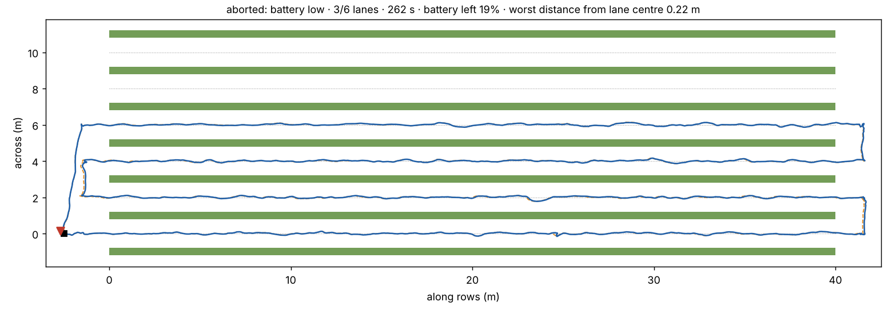

# rowpilot-bt

[](https://github.com/NadaAbbas444/rowpilot-bt/actions/workflows/test.yml)

[](LICENSE)

**A GPS-free greenhouse drone flown by a behaviour tree.**

A drone that flies the lanes between greenhouse crop rows without GPS. It localizes with visual odometry, keeps itself centred in each lane using the crop rows it sees in a depth camera, and runs the mission as a **behaviour tree** that handles a low battery and lost tracking safely.

Target hardware: a flight controller running PX4, a Raspberry Pi 5 companion computer on SkiffOS, an Intel RealSense depth camera (lane perception and visual odometry), a Pi camera, and a battery.

The core of this repo is the part that does not depend on a simulator or the hardware: perception, control, the behaviour tree, and a lightweight simulator that sits behind the same `Vehicle` interface PX4 will use. It runs anywhere with Python 3.10+ and is covered by tests and CI.



*`python -m rowpilot run --battery 60`: the reserve is reached at the start of lane 4, so the tree flies home along the lane (not through the crop) and lands. Blue is the true path; dashed orange is what visual odometry believed.*

## Run it

```bash
pip install -e ".[dev]"
python -m rowpilot tree                                    # print the behaviour tree
python -m rowpilot run --out runs/nominal                  # full 6-lane greenhouse
python -m rowpilot run --battery 60 --out runs/low-battery # returns home on the reserve
python -m rowpilot run --vo-dropout 60:1.5 --vo-dropout 200:10 --out runs/vo
pytest -q
```

Each run writes `events.jsonl` (every node's status changes and log lines), `trace.csv` (true and estimated pose, battery and active node at 10 Hz), `summary.json` and `path.png`.

## How it works

| Piece | File | What it does |
|---|---|---|
| Layout | `rowpilot/layout.py` | Greenhouse geometry: lanes, crop rows, headlands, serpentine lane order, home |
| Lane perception | `rowpilot/perception.py` | Horizontal depth scan → distance from the lane centre and heading error. RANSAC line fit for each crop face, nearest face wins, both faces fitted together with a shared slope, sanity checks (parallel faces, correct lane width). Says "don't know" rather than guessing |
| Control | `rowpilot/control.py` | Lane follower (PID on the sideways offset, P on heading, slows down when off-centre); waypoint path following with cross-track correction |
| Mission | `rowpilot/mission.py` | The behaviour tree (py_trees), plus lane-centric localization: inside a lane, the perceived offset corrects the VO cross-track drift |
| Vehicle interface | `rowpilot/vehicle.py` | `state()`, `arm()`, `disarm()`, `send(velocity)`, `depth_scan()`, which is all the mission needs |
| Simulator | `rowpilot/sim.py` | Velocity-loop lag, gusts, drifting VO with dropouts, battery drain, RealSense-like depth rays hitting the crop faces and row ends. Keeps ground truth for tests |
| Runner | `rowpilot/runner.py` | Ticks the tree at 10 Hz and records per-node events (`on_event` streams them live) |

### The behaviour tree

```
Root (Sequence, re-evaluated every tick)
├── SafetyGuard (Selector)
│   ├── AllHealthy: NotAborted, BatteryAboveReserve, VOHealthy
│   └── Failsafe (ends the run when it finishes)
│       ├── VOGlitch: VOLostBriefly → Hover               pause, then resume the mission
│       ├── EmergencyLand: MustLandNow → LandHere         battery critical / VO lost > 3 s
│       └── ReturnAndLand: Airborne → ReturnHome → Land   low battery / a mission step failed
└── Mission (Sequence)
    ├── Preflight, Takeoff
    ├── Lane 1: GoToEntry → Align → Sweep → Exit
    ├── … one subtree per lane
    └── ReturnHome, Land
```

The guard is ticked before the mission on every tick, so a failing check interrupts whatever is running. That is why mission nodes are **re-entrant**: each remembers when it has finished, so after a VO glitch the mission continues from the node it was in instead of starting over. This is the main design rule to keep when adding nodes.

### What the tests check

- Perception matches the true offset and heading across positions and angles, including lane entries seen from the headland, and is never confidently wrong in hard poses.
- Full missions against ground truth: every lane swept and landed; the whole 6-lane greenhouse on one battery; strong gusts without hitting the crop; return home on a low battery; hover and resume on a short VO dropout; land in place on a long one; refusing to take off on a low battery.

## PX4 SITL + Gazebo (in progress)

The same tree is meant to fly the real PX4 software stack in Gazebo, through a `Vehicle` implementation over MAVSDK:

| Piece | File |
|---|---|
| Greenhouse world generated from the same `GreenhouseLayout` | `rowpilot/gazebo_world.py` |
| `gh_x500`: x500 with vision odometry (no GPS) and a forward horizontal lidar standing in for one row of the RealSense depth image | `px4/models/gh_x500/` |
| GPS-free, offboard-only airframe | `px4/airframes/4099_gz_gh_x500` |
| Copies the above into a PX4-Autopilot checkout | `px4/install.sh` |
| `Px4Vehicle` (MAVSDK offboard velocity) and the live runner | `rowpilot/px4.py` |

Status: written, **not yet flown**. The next step is running it against PX4 SITL and fixing what that shows.

## Next steps

1. **Fly the tree in PX4 SITL + Gazebo** (see above).
2. **Node editor**: React Flow frontend + FastAPI backend that runs the tree, streaming `on_event` over a WebSocket so each node lights up and shows its own log (`python -m rowpilot tree --json` already exports nodes and edges).
3. **Hardware**: RealSense driver and visual odometry (e.g. OpenVINS or VINS-Fusion) on the Pi 5, feeding PX4's EKF2 as external vision; one row of the depth image as the lane scan.
