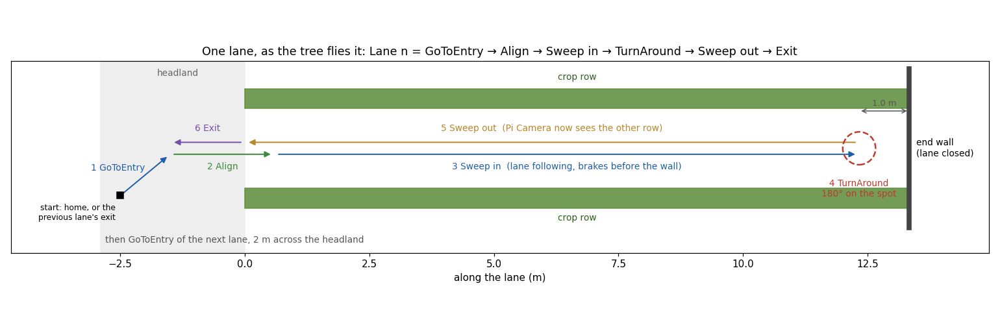
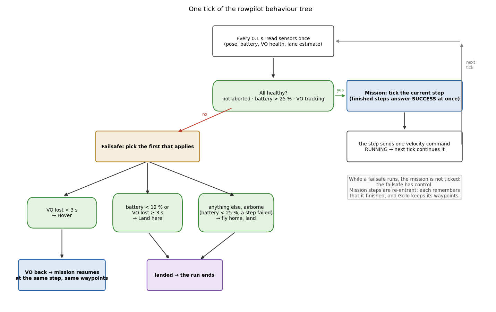
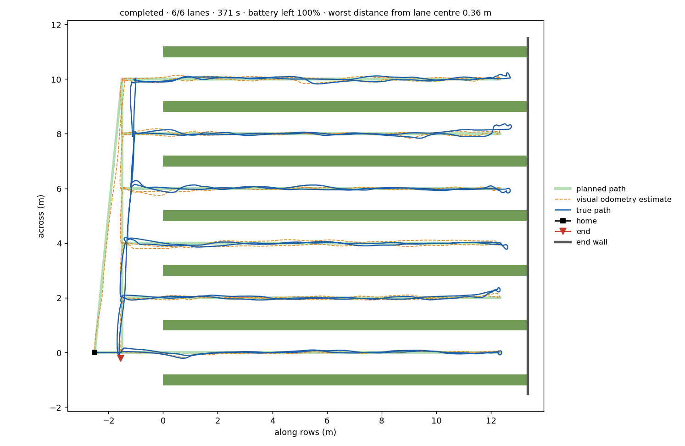

# rowpilot-sim-behavior-trees

[](https://github.com/NadaAbbas444/rowpilot-sim-behavior-trees/actions/workflows/test.yml)

[](LICENSE)

**A drone for GPS-denied greenhouses, flown by a behaviour tree.**

A drone that flies the lanes between greenhouse crop rows, where GPS is denied (glass, steel and dense crop). The lanes are dead ends, as in the real greenhouse: the drone flies into each lane, turns round short of the end wall and flies back out the same way. It localizes with visual odometry, keeps itself centred in each lane using the crop rows it sees in a depth camera, and runs the mission as a **behaviour tree** that handles a low battery and lost tracking safely.

Target hardware: the FireFly 2 quadcopter (2004 motors, 4-inch props, 4S Molicel 21700 pack) with a flight controller running ArduPilot (ArduCopter), a Raspberry Pi 5 companion computer on SkiffOS, an Intel RealSense D435i at the front tilted 15° down (depth for lane perception; stereo infrared + IMU for OpenVINS visual-inertial odometry), a Raspberry Pi Camera Module 3 on the left side for plant images, and a battery. No GPS, no compass.

The core of this repo is the part that does not depend on a simulator or the hardware: perception, control, the behaviour tree, and a lightweight simulator behind the same `Vehicle` interface the ArduPilot simulation uses. It runs anywhere with Python 3.10+ and is covered by tests and CI. The full simulation (ArduPilot SITL + Gazebo + OpenVINS, with the FireFly model) runs on Ubuntu 22.04.

**See it in action: [the showcase page](https://nadaabbas444.github.io/rowpilot-sim-behavior-trees/)** (videos of the editor and the Gazebo flight).

**New here? Start with [docs/setup.md](docs/setup.md)**: setting it up on your laptop and running everything, step by step.

## Documentation

| | |
|---|---|
| [docs/setup.md](docs/setup.md) | **set up and run everything**: the Python simulator, the editor, Gazebo + ArduPilot + OpenVINS; stopping and cleaning up; troubleshooting |
| [docs/editor.md](docs/editor.md) | the behaviour tree editor: using it, how it is built, its API |
| [docs/reference.md](docs/reference.md) | every command, script, option and environment variable; ports and processes |
| [docs/how-it-works.md](docs/how-it-works.md) | the whole system: processes and topics, the behaviour tree node by node, failsafes, how the drone finds each lane, perception, control, localization, what each run saves |
| [docs/bt/](docs/bt/) | behaviour tree diagrams |
| [docs/deployment.md](docs/deployment.md) | running it on the real drone |

## Quick start

| | |
|---|---|
| Python simulator (any OS, 5 min) | `pip install -e ".[dev,plot]"` then `python -m rowpilot run --out runs/nominal` |
| The editor (+ Node.js 18) | `cd web && npm ci && npm run build && cd ..` then `python -m rowpilot editor`, open http://127.0.0.1:8000 |
| Gazebo + ArduPilot + OpenVINS (Ubuntu 22.04) | `./scripts/setup_ardupilot_sim.sh` once, then `./scripts/run_ardupilot_sim.sh` or *Run settings → Gazebo* in the editor |

Full steps: [docs/setup.md](docs/setup.md).


*`python -m rowpilot run --battery 45`: the battery reaches the reserve in lane 3, so the tree turns round, flies back out of the dead-end lane (never through the crop) and home, and lands. Blue is the true path; dashed orange is what visual odometry believed.*

## Run it (Python simulator)

```bash
python3 -m venv .venv && source .venv/bin/activate   # Ubuntu: sudo apt install python3-venv if missing
pip install -U pip && pip install -e ".[dev,plot]"
python -m rowpilot tree                                    # print the behaviour tree
python -m rowpilot run --out runs/nominal                  # full 6-lane greenhouse
python -m rowpilot run --battery 45 --out runs/low-battery # returns home on the reserve
python -m rowpilot run --vo-dropout 60:1.5 --vo-dropout 200:10 --out runs/vo
pytest -q
```

Each run writes `events.jsonl` (every node's status changes and log lines), `trace.csv` (true and estimated pose, battery and active node at 10 Hz), `summary.json` and `path.png`.

## Behaviour tree editor

Draw or change the tree in the browser, run it and watch every node live: running nodes light up, each node keeps its own log, and a map shows the flight. Run it in the fast Python simulator, or in the full chain (Gazebo + ArduPilot SITL + OpenVINS), with ArduPilot's, EKF3's and OpenVINS's messages in the log next to the tree's. React + React Flow page, FastAPI server running the same tree code. **[docs/editor.md](docs/editor.md)**

```bash
pip install -e ".[editor]"
cd web && npm ci && npm run build && cd ..
python -m rowpilot editor          # http://127.0.0.1:8000
```


## How it works

| Piece | File | What it does |
|---|---|---|
| Layout | `rowpilot/layout.py` | Greenhouse geometry: lanes, crop rows, headland, home. Lanes closed at the far end (default: in and back out of each lane) or open at both ends (`--open-ends`: serpentine) |
| Lane perception | `rowpilot/perception.py` | Horizontal depth scan → distance from the lane centre and heading error. RANSAC line fit for each crop face, nearest face wins, both faces fitted together with a shared slope, sanity checks (parallel faces, correct lane width). Says "don't know" rather than guessing |
| Control | `rowpilot/control.py` | Lane follower (PID on the sideways offset, P on heading, slows down when off-centre); waypoint path following with cross-track correction |
| Mission | `rowpilot/mission.py` | The behaviour tree (py_trees), plus lane-centric localization: inside a lane, the perceived offset corrects the VO cross-track drift |
| Vehicle interface | `rowpilot/vehicle.py` | `state()`, `arm()`, `disarm()`, `send(velocity)`, `depth_scan()`, which is all the mission needs |
| Simulator | `rowpilot/sim.py` | Velocity-loop lag, gusts, drifting VO with dropouts, battery drain, RealSense-like depth rays hitting the crop faces, row ends and the end wall. Keeps ground truth for tests |
| Runner | `rowpilot/runner.py` | Ticks the tree at 10 Hz and records per-node events (`on_event` streams them live) |

### The behaviour tree






*Drawn from the code by `python scripts/bt_diagrams.py`; [docs/how-it-works.md](docs/how-it-works.md) explains every node.*

```
Root (Sequence, re-evaluated every tick)
├── SafetyGuard (Selector)
│   ├── AllHealthy: NotAborted, BatteryAboveReserve, VOHealthy
│   └── Failsafe (ends the run when it finishes)
│       ├── VOGlitch: VOLostBriefly → Hover               pause, then resume the mission
│       ├── EmergencyLand: MustLandNow → LandHere         battery critical / VO lost > 3 s
│       └── ReturnAndLand: Airborne → ReturnHome → Land   low battery / a mission step failed
└── Mission (Sequence)
    ├── Preflight, Takeoff
    ├── Lane 1: GoToEntry → Align → Sweep in → TurnAround → Sweep out → Exit
    │           (open lanes: GoToEntry → Align → Sweep → Exit)
    ├── … one subtree per lane
    └── ReturnHome, Land
```

The guard is ticked before the mission on every tick, so a failing check interrupts whatever is running. That is why mission nodes are **re-entrant**: each remembers when it has finished, so after a VO glitch the mission continues from the node it was in instead of starting over. This is the main design rule to keep when adding nodes.

### What the tests check

- Perception matches the true offset and heading across positions and angles, including lane entries seen from the headland, and is never confidently wrong in hard poses.
- Full missions against ground truth: every lane swept and landed; dead-end lanes flown in and back out without nearing the end wall, open lanes still serpentine; the whole 6-lane greenhouse on one battery; strong gusts (0.5 m/s rms, with the flight controller's measured delay) without hitting the crop; return home on a low battery; hover and resume on a short VO dropout; land in place on a long one; refusing to take off on a low battery.

## ArduPilot SITL + Gazebo (the real drone's setup)

The behaviour tree flies ArduCopter SITL in the Gazebo greenhouse, with the real drone's sensors and estimator chain:
Gazebo D435i → OpenVINS (no ROS) → MAVLink ODOMETRY → ArduPilot EKF3 (ExternalNav, GPS-denied) → GUIDED velocity targets from the tree.

| Piece | File |
|---|---|
| `gh_firefly`: the FireFly 2 from its SolidWorks design (body and props, rotor positions, sensor positions) + RealSense D435i (front, 15° down) + Pi Camera Module 3 (left) | `rowpilot/airframe.py`, `rowpilot/sensors.py` |
| FireFly 2 meshes, simplified from the SolidWorks export (620k → 27k triangles): `python -m rowpilot.cad_import <export> ardupilot/firefly/meshes` | `rowpilot/cad_import.py`, `ardupilot/firefly/meshes/` |
| `gh_iris`: ArduPilot Iris with the same sensors (`VEHICLE=iris`) | `rowpilot/sensors.py` |
| Greenhouse world: tomato rows, pipe rails, posts, sticky tape, ground cover, glass facades | `rowpilot/gazebo_world.py`, `rowpilot/greenhouse_assets.py` |
| OpenVINS config for the D435i | `rowpilot/openvins_config.py` |
| VIO bridge: D435i stereo IR + IMU → OpenVINS → odometry | `vio_bridge/` |
| OpenVINS pose → greenhouse frame | `rowpilot/vio_link.py` |
| D435i accelerometer computed from the physics (simulation only, see below) | `rowpilot/imu_synth.py` |
| `ArduPilotVehicle` (MAVLink: ODOMETRY to EKF3, GUIDED take-off and velocity targets, LAND mode) | `rowpilot/ardupilot.py` |
| ArduCopter parameters for GPS-denied flight, and the FireFly's frame, battery and rate gains | `ardupilot/gps_denied.parm`, `ardupilot/firefly.parm` |

```bash
./scripts/setup_ardupilot_sim.sh                                 # once: ArduPilot SITL, ardupilot_gazebo, OpenVINS, the bridge, .venv-sim
./scripts/run_ardupilot_sim.sh ~/ardupilot ~/ardupilot_gazebo    # opens Gazebo and flies the FireFly; results in runs/ardupilot-<time>/
VEHICLE=iris ./scripts/run_ardupilot_sim.sh ~/ardupilot ~/ardupilot_gazebo   # the ArduPilot Iris instead
```

**Result, FireFly 2** (6 dead-end lanes, 13.3 m rows, OpenVINS → EKF3, scored against Gazebo ground truth): every lane flown in to 1 m short of the end wall, turned round (~6 s) and flown back out, home through the headland, landed by ArduCopter's LAND mode. **50–104 mm RMS from the lane centre, 0.36 m worst case**, closest approach to the end wall 0.58 m (the turning point is 1.0 m before it; the drone overshoots by up to ~0.4 m while braking), 371 s, flown from a fresh clone set up with `scripts/setup_ardupilot_sim.sh` (two earlier runs: 37–117 mm RMS). The visual odometry drifts by roughly 0.6 % of the distance flown, so the touchdown is about 0.9 m from the take-off spot. The plot shows the planned path (green), the true path (blue) and what OpenVINS + EKF3 believed (orange).



Earlier, with the Iris and open lanes (serpentine): every lane swept, 48–112 mm RMS from the lane centre, 0.31 m worst case, 239 s ([plot](docs/ardupilot-gazebo-run.png)).

FireFly model: shape, rotor positions and sensor positions come from the SolidWorks design; mass (0.72 kg) and inertia are estimated from the CAD parts with typical component masses, and the thrust (7 N per motor) is typical for 2004 motors on 4-inch props. Both are estimates until the drone is weighed and the motors are known (see `rowpilot/airframe.py`).

The Gazebo window follows the drone and shows its cameras live (D435i infrared and depth, Pi Camera):


How the whole system works (processes and topics, the behaviour tree node by node, failsafes, perception, control, localization, what each run saves): **[docs/how-it-works.md](docs/how-it-works.md)**. Running it on the real FireFly, without ROS: **[docs/deployment.md](docs/deployment.md)**.

Each run folder has `gazebo.log`, `arducopter.log`, `openvins.log`, `imu_synth.log`, `events.jsonl`, `trace.json` (estimate, ground truth, lane estimate and commands at 10 Hz), `summary.json` and `path.png`. `HEADLESS=1` runs without the Gazebo window; `GPU=0` keeps the default OpenGL renderer.

Things learned getting it to fly, all handled in the scripts and code:
- **GPU rendering.** On a hybrid-graphics laptop OpenGL falls back to llvmpipe (CPU) and the five cameras slow Gazebo to 0.004× real time. The run script uses NVIDIA PRIME offload when there is an NVIDIA GPU: 1.0× real time.
- **1 kHz physics.** In SITL the IMU rate is the physics rate, and ArduCopter's pre-arm check needs it ≥ 1.8 × its 400 Hz loop: 400 Hz physics never arms.
- **gz-transport on loopback** (`GZ_IP=127.0.0.1`): with several network interfaces (Wi-Fi, docker0) the GUI's "starting world" message can miss the server, which then waits forever. Gazebo also sometimes segfaults at start-up (a getenv race in gz-transport); the run script restarts it.
- **Take-off.** A GUIDED velocity target cancels ArduCopter's NAV_TAKEOFF climb, and on the ground ArduCopter does not climb on velocity targets (it disarms). The vehicle holds velocity targets back until the take-off is airborne.
- **Gazebo's IMU accelerometer is wrong while the drone rotates** (0.2–0.6 m/s² sideways in yaw turns, while the gyro and the images agree with the true motion). OpenVINS integrated it into a false velocity and diverged in every turn. Gazebo's gyro is kept; the accelerometer is computed from the sensor link's physics pose (1 kHz), with BMI055-like noise and bias. With it, OpenVINS stays within 0.11 m of ground truth through 0.8 rad/s turns. This is a simulator fix only; the real D435i IMU goes straight to OpenVINS.
- **Visual features.** The floor is tiled ground cover with dirt and leaf litter, and glass facades with columns and glazing bars close the greenhouse, so the cameras have something to track in the headlands. SDF's default metalness (0.5) renders a floor dark and featureless; it is set to 0.
- **ZUPT only before take-off.** Hovering or creeping, the image barely changes and OpenVINS's zero-velocity test passes for a drone that is not standing still.
- **The FireFly's rotors.** The rotor model is the Iris's (a joint spun at ArduPilot's commanded speed, two lift-drag blades), with the blade area set for the FireFly's thrust. The Iris's rotor inertia is blade-shaped (not symmetric about the spin axis): on a body this light, four of them spinning at 420 rad/s shook it at 17–20 m/s² and ArduCopter lost attitude control within a minute. FireFly rotors are discs, with a smaller inertia and a matching speed-loop gain.
- **FireFly rate gains** (`ardupilot/firefly.parm`). On the long, light frame pitch and yaw respond about twice as strongly as on the Iris: with ArduCopter's default gains yaw oscillated at ±25°/s, the visual odometry drifted 3 m sideways in one lane, and the drone fell in its first turn. Pitch and yaw gains are halved. Roll, the lightest axis, limit-cycled at 20 Hz with the default D gain; 0.0015 removes it (roll-rate noise 107 → 9°/s). Tune these again on the real drone.
- **The flight controller's response.** ArduCopter follows GUIDED velocity targets with ~0.5 s dead time and a 0.3 s lag (its jerk and acceleration limits). The Python simulator now models that, and the lane and waypoint controllers are tuned for it: the old gains made the drone swing across the lane. With this delay, the drone holds the lanes in gusts up to 0.5 m/s rms (20/20 runs); at 0.8 m/s most runs touch the crop.

## PX4 SITL + Gazebo

The older PX4 path (kept, not the priority: the real drone runs ArduPilot). The same behaviour tree flies the PX4 flight stack in Gazebo, through a `Vehicle` implementation over MAVSDK. No GPS and no magnetometer: PX4's EKF2 fuses only the vision odometry, as on the real drone.

| Piece | File |
|---|---|
| Greenhouse world generated from the same `GreenhouseLayout` | `rowpilot/gazebo_world.py` |
| `gh_x500`: x500 with vision odometry and a forward horizontal lidar standing in for one row of the RealSense depth image (cropped to its 87° field of view) | `px4/models/gh_x500/` |
| Airframe for GPS-denied flight (no GPS, no compass, offboard only) | `px4/airframes/4099_gz_gh_x500` |
| Copies the above into a PX4-Autopilot checkout | `px4/install.sh` |
| `Px4Vehicle` (MAVSDK offboard velocity, PX4 Land mode for touchdown) and the live runner | `rowpilot/px4.py` |

**Result** (6 lanes, 40 m rows, scored against Gazebo ground truth): every lane swept, **5–8 mm RMS from the lane centre, 43 mm worst case**, home through the headland, and touchdown by PX4's Land mode.


### Run it on your machine (Ubuntu 22.04 / 24.04)

The scripts repeat the steps used to fly it headless on Ubuntu 24.04; the Gazebo window itself has not been tested yet.

```bash
./scripts/setup_px4_sim.sh      # once: PX4, Gazebo Harmonic, the greenhouse world and drone (20-40 min)
./scripts/run_px4_sim.sh        # opens Gazebo and flies the mission; results in runs/px4-<time>/
```

Things learned getting PX4 to fly it, all handled in `rowpilot/px4.py`:
- PX4 refuses to arm indoors in its default Hold mode (it needs a global position), so it switches to offboard first, then arms.
- Without GPS, PX4 sends no global position, so MAVSDK's `heading()` is NaN; yaw comes from attitude.
- PX4's local frame shares the Gazebo world origin, because the vision odometry is reported in world coordinates.
- MAVSDK's local-position flag drops out for single messages, so it is debounced before the tree treats it as lost VO.
- In offboard velocity mode PX4's land detector never confirms touchdown; landing is handed to PX4's Land mode.

## Next steps

1. **Hardware**: RealSense driver and OpenVINS on the Pi 5, feeding ArduPilot's EKF3 as external navigation, as in the simulation; the depth image as the lane scan.
2. **Measure the FireFly** and put the numbers in `rowpilot/airframe.py`: its weight (the model's 0.72 kg is an estimate from the CAD parts), motor KV and prop size and pitch (the model assumes ~7 N of thrust per motor), the D435i's tilt and the Pi Camera's side. The TF-Luna rangefinder in the CAD is not simulated yet.
