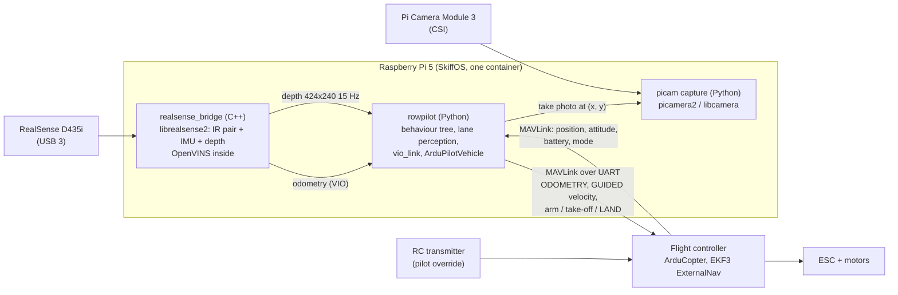

# Running rowpilot on the real FireFly (without ROS)

The simulation already runs the real drone's software chain: OpenVINS on the D435i's infrared pair
and IMU, the behaviour tree, lane perception on the depth image, MAVLink to ArduCopter with EKF3 on
external navigation. On the drone, the only thing that changes is **where the sensor data comes from**
(the cameras instead of Gazebo) and **how MAVLink reaches the flight controller** (a serial port
instead of TCP). This page says what carries over as it is, what still has to be written, and how to
bring it up safely.

## What runs on the drone

No ROS: the processes on the Pi talk over gz-transport (the same library the simulation uses; it
installs without Gazebo, `libgz-transport13`) or, if you prefer, a plain UDP/ZeroMQ socket; the
flight controller is reached with MAVLink.

## What carries over unchanged

| Piece | File | Notes |
|---|---|---|
| Behaviour tree, failsafes | `rowpilot/mission.py` | identical |
| Lane perception | `rowpilot/sensors.py`, `rowpilot/perception.py` | identical; set `FIREFLY_RIG` to the measured D435i mount (position, tilt) |
| Controllers | `rowpilot/control.py` | identical; re-check the gains in the first flights |
| OpenVINS → map frame, ODOMETRY to EKF3 | `rowpilot/vio_link.py`, `rowpilot/ardupilot.py` | identical |
| MAVLink vehicle (GUIDED, take-off, LAND, state) | `ArduPilotVehicle` in `rowpilot/ardupilot.py` | connect with a serial URL, e.g. `/dev/ttyAMA0,921600` |
| OpenVINS estimator settings | `rowpilot/openvins_config.py` | replace the camera/IMU calibration with the drone's own (see below) |
| EKF3 GPS-denied setup | `ardupilot/gps_denied.parm` | load on the flight controller, without the `SIM_*` lines |

## What has to be written

1. **`realsense_bridge`**: the D435i reader. `vio_bridge.cpp` already feeds OpenVINS strictly in time
   order; its input side (gz-transport subscriptions) is replaced by a librealsense2 pipeline:
   - streams: infrared 1 and 2 (640x480 Y8, 30 Hz), gyro (200/400 Hz), accel (100/250 Hz), depth
     (424x240 Z16, 15 Hz); turn the IR emitter **off** for the IR images OpenVINS uses (the dot
     pattern moves with the drone and confuses the tracker), or alternate it with the depth frames;
   - the D435i gives gyro and accel at different rates: interpolate the accelerometer to the gyro
     timestamps (OpenVINS wants combined IMU samples);
   - one process must own the camera (librealsense lets only one process open it), so the same
     bridge also **publishes the depth image** for the lane perception.
2. **`RealSenseSensors`** (Python): the drone-side replacement for `GazeboSensors` in
   `rowpilot/ardupilot.py`: subscribe to the bridge's depth topic, use the system clock instead of
   the simulation clock, no ground truth. Small: about 30 lines.
3. **Pi Camera capture**: `picamera2` (libcamera), still images saved with the drone's pose and lane
   (e.g. every 0.5 m along the sweep), triggered from a node in the tree or by distance in the sweep.
4. **A `rowpilot fly` command**: like `rowpilot ardupilot`, with the serial MAVLink URL, the real
   sensors and a log folder on the Pi (same `events.jsonl`, `trace.json`, `summary.json`).
5. **Mode-change handling**: if the pilot switches the flight mode on the RC transmitter, the tree
   must stop sending GUIDED targets and end the mission: read the mode from HEARTBEAT's `custom_mode`
   in `ArduPilotVehicle.state()` and add a `PilotHasControl` condition to the guard.
6. **Packaging for SkiffOS**: one arm64 container image with librealsense2, OpenVINS and the bridge
   (built from `vio_bridge/`), Python with `rowpilot` and pymavlink, started by a systemd unit.
   SkiffOS runs it like any Docker container; give it `/dev/bus/usb`, the CSI camera and the UART.

## Calibration

- **D435i camera ↔ IMU**: run Kalibr (or OpenVINS's own calibration) on a recording of the drone's
  D435i moved by hand in front of an AprilGrid; put the result into `openvins_config.py`. The
  factory extrinsics from librealsense (`rs2::stream_profile::get_extrinsics_to`) are a reasonable
  first start.
- **IMU noise**: the D435i's BMI055 values in `D435i` (`rowpilot/sensors.py`) are typical; an Allan
  variance of a 2-hour static recording gives the drone's own.
- **D435i mount**: measure its position from the body centre and its tilt, and set `FIREFLY_RIG`.
- **VIO delay**: ArduPilot needs the delay between an image and its ODOMETRY message: set
  `VISO_DELAY_MS` (start with 50) and check EKF3's innovations in the log.

## Flight controller setup

- Connect a TELEM port to the Pi's UART (TX/RX/GND), `SERIALn_PROTOCOL 2` (MAVLink2),
  `SERIALn_BAUD 921`.
- Load `ardupilot/gps_denied.parm` (without `SIM_*`): EKF3 sources = ExternalNav, `VISO_TYPE 1`, no
  GPS, no compass.
- Frame, motor order and direction as in `ardupilot/firefly.parm`; calibrate accelerometers and ESCs
  as usual.
- Rate gains: the simulation's (`firefly.parm`) are a starting point only. Tune on the real drone
  (ArduCopter's AutoTune in AltHold works with VIO).
- Failsafes on the flight controller itself, independent of the Pi: RC loss → LAND,
  `FS_EKF_ACTION` → LAND, battery failsafe → LAND, and a companion heartbeat check.

## Bringing it up safely

1. **Bench, props off**: camera bridge running, carry the drone by hand down a lane; check OpenVINS
   stays within a few cm of the lane over a walk in and out, and the lane perception's offset.
2. **Props off, flight controller connected**: EKF3 shows "using external nav", the position in the
   ground station follows the drone as you carry it.
3. **First hover, pilot in control** (LOITER, tethered or in a net): VIO-based position hold.
4. **GUIDED, short legs** from the tree with the pilot's hand on the mode switch: take-off, hover,
   land; then one lane at low speed (`sweep_speed` 0.3).
5. **Full mission.**

## Watching it live

Gazebo's camera screens are a simulation tool. On the drone, the equivalents are:

- the **ground station** (Mission Planner / QGroundControl over a telemetry radio or Wi-Fi via
  mavlink-router): position, attitude, mode, battery, EKF status;
- a **camera stream** from the Pi over Wi-Fi (e.g. the infrared image with OpenVINS's tracked
  features, and the depth image, as MJPEG or WebRTC) for the bench tests and first flights;
- the run logs on the Pi, copied off after each flight.

## If you would rather use ROS 2

Everything above can also be done with ROS 2 (Humble): `realsense-ros` for the D435i, OpenVINS's
ROS 2 node (`ov_msckf`), MAVROS for MAVLink, and the behaviour tree as a node. You would get rviz,
rqt_graph and rosbag, at the cost of a much larger install on the Pi (and in SkiffOS) and more
moving parts. The rowpilot code is written so either way works: the tree only sees the `Vehicle`
interface.
