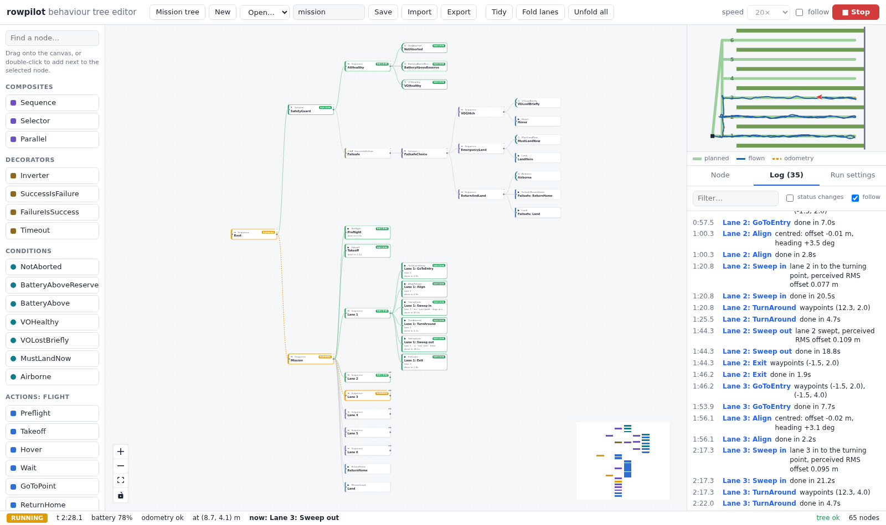
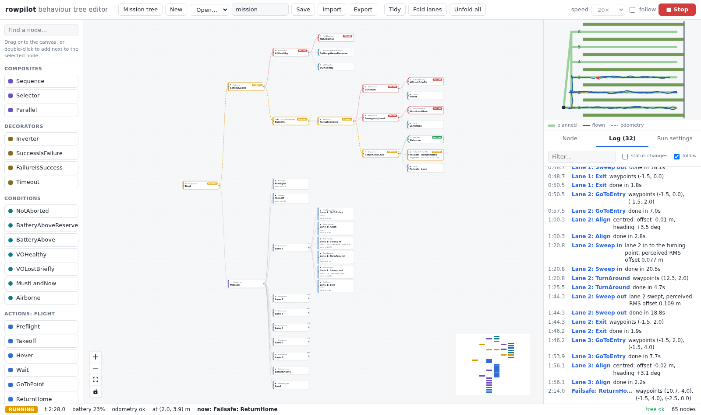
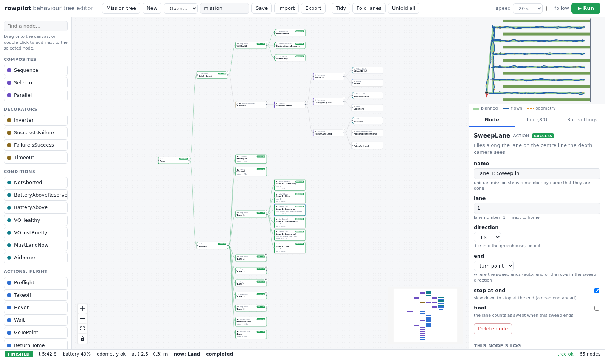
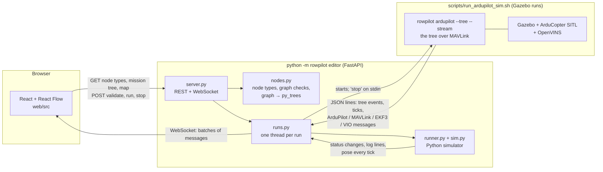

# The behaviour tree editor

A web page for the mission's behaviour tree: draw or change the tree, run it, and watch every node
live. Running nodes light up, each node shows its own log, and a map shows where the drone flies.
The page is React + React Flow; the server is FastAPI and runs the same Python tree code as
`python -m rowpilot run` and the ArduPilot simulation.

A tree runs in one of three simulators (*Run settings*):

| | Python simulator | Gazebo + ArduPilot + OpenVINS |
|---|---|---|
| What runs | the tree, lane perception and control against a modelled drone | the full chain, as on the drone: Gazebo (window with the drone and live camera screens), ArduCopter SITL, OpenVINS on the simulated D435i, the tree flying ArduPilot over MAVLink |
| Speed | any (1× to as fast as it goes); a 6-lane mission in seconds | real time; ~10 s to start, a 6-lane mission ~7 minutes |
| Log | the tree's nodes | the tree's nodes **and the flight stack**: ArduPilot's own messages (pre-arm checks, EKF3, arming), what rowpilot asks over MAVLink (GUIDED, arm, take-off, LAND), EKF3 getting its position from the visual odometry, OpenVINS initialising, and the start-up of each part |
| Needs | Python only | the level 2 setup ([setup.md](setup.md)); the editor shows what is missing |
| Settings | greenhouse, mission, battery, gusts, odometry dropouts, seed | greenhouse, mission, drone (FireFly 2 or Iris), Gazebo window on/off |

The third, *Isaac Sim + ArduPilot + OpenVINS*, is the Gazebo column with NVIDIA Isaac Sim in place of
Gazebo: the same greenhouse, settings and log, the drone (FireFly) only, real time. It needs level 3b of
[setup.md](setup.md); until then it is greyed out with what is missing. Not yet flown end to end.

**Robot** (*Run settings*): the FireFly 2 drone, or the **pipe-rail trolley** (Python simulator, or Gazebo + OpenVINS without ArduPilot).
Changing robot loads that robot's mission tree, and the palette offers its nodes (the drone's flight
and lane nodes; the trolley's driving and rail nodes; composites, decorators and the shared checks for
both). A tree with another robot's nodes does not validate. The map draws the trolley as its chassis.



## Start it

You need Python 3.10+ and Node.js 18+ (tested with Node 22).

```bash
pip install -e ".[editor]"            # FastAPI and uvicorn (".[dev]" includes them too)
cd web && npm ci && npm run build && cd ..
python -m rowpilot editor             # then open http://127.0.0.1:8000
```

`npm run build` puts the page into `web/dist/`, which the Python server serves. Saved trees go to
`trees/` (change it with `--trees <folder>`; `--port` and `--host` as usual). For Gazebo runs the
server looks for ArduPilot in `~/ardupilot` and `~/ardupilot_gazebo` (`--ardupilot`,
`--ardupilot-gazebo` to change) and prints at start whether Gazebo runs are ready. Each Gazebo run
saves its results (logs, `path.png`, `summary.json`, the tree) in `runs/editor-<date>-<time>-<id>/`.

**Working on the page itself:** run the server (`python -m rowpilot editor`) and, in a second terminal,
`cd web && npm run dev`, then open http://localhost:5173. Vite reloads the page on every change and
passes `/api` (and the run's WebSocket) to the Python server.

**Stopping:** Ctrl+C in the editor's terminal (this also stops a run it started). If a Gazebo run
left processes behind (e.g. after closing the Gazebo window), see
[setup.md: stopping and cleaning up](setup.md#stopping-and-cleaning-up); problems:
[setup.md: troubleshooting](setup.md#troubleshooting). All options: [reference.md](reference.md).

## Using it

| | |
|---|---|
| **Mission tree** | loads the greenhouse mission (`mission.build_tree`), sweeping every lane of the greenhouse. Lanes 2 onwards start folded; **Unfold all** shows them |
| **Lanes − 3 of 6 +** | which lanes the tree sweeps. The greenhouse is fixed (6 lanes, *Run settings*; the Gazebo world always has all of them); the tree decides how many to sweep. **+** adds the first lane the tree does not sweep yet, right after the last lane, with the same steps as the mission tree; **−** removes the last lane with all its steps |
| **Palette** (left) | every node type, grouped. Drag one onto the canvas, or double-click it: with a node selected, the new node becomes its last child (or, if the selected node cannot take children, comes right after it) |
| **Connecting** | drag from a parent's right handle to a child's left handle. The editor refuses what cannot work: children on an action or condition, a second child on a decorator, two parents, a cycle |
| **Order** | a parent ticks its children **top to bottom, as drawn**. Move a node up or down to change the order; **Tidy** lays the tree out again keeping that order |
| **Node** tab | the selected node: what it does, its name and parameters, and its own log from the last run |
| **Delete** | the Delete key or the Node tab's button; a composite is deleted with everything under it (a lane with its steps) |
| **Problems** | the server checks the tree as you edit (unknown lane, missing child, duplicate name, loose node...). Nodes with a problem get a dashed red border, the status bar counts them, and **Run** waits until there are none |
| **Run** | runs the tree in the chosen simulator (the badge next to the speed says which). Python: at the chosen **speed** (simulated seconds per real second; *max* as fast as it goes). Gazebo: real time, the Gazebo window opens. **follow** keeps the running node in view |
| **Stop** | Python: ends the run. Gazebo: lands the drone where it is and closes the simulation (or closes it at once if it is still starting) |
| **Log** tab | every node's log lines as they happen; click a node's name to jump to it. In Gazebo runs also the flight stack's messages, labelled ArduPilot, MAVLink, EKF3, VIO or setup. Filters: *tree*, *flight stack*, *status changes* (every SUCCESS / FAILURE / RUNNING) |
| **Run settings** | the simulator; the greenhouse (lanes, dead-end or open lanes, sizes; in Gazebo the world is generated with them); the mission (altitude, sweep speed); Python only: start battery, gusts, visual odometry dropouts, seed; Gazebo only: the drone and the window |
| **Map** (top right) | the greenhouse from above: the planned path (green), where the drone really flew (blue) and where visual odometry thought it was (dashed orange) |
| **Save / Open** | trees saved on the server (`trees/<name>.json`); **Export / Import** downloads or loads a JSON file. The page also keeps your current tree in the browser |

Node names must be unique: mission steps remember by name that they are done, so the mission can
pick up where it was after a failsafe pauses it.



*Start battery 45%: in lane 3 `BatteryAboveReserve` fails (red), so `SafetyGuard` switches to the
failsafe branch, which flies back out of the lane and home (amber); the mission branch is no longer
ticked.*



## The nodes

The editor offers the nodes the mission is built from, plus a few general ones. Hover over one in
the palette for what it does.

| Kind | Nodes |
|---|---|
| Composites | `Sequence`, `Selector` (both with `memory`: off = start from the first child every tick, so a failing check interrupts what runs after it, as the mission does), `Parallel` |
| Decorators | `Inverter`, `SuccessIsFailure`, `FailureIsSuccess`, `Timeout` (simulated seconds) |
| Conditions | `NotAborted`, `BatteryAboveReserve`, `BatteryAbove`, `VOHealthy`, `VOLostBriefly`, `MustLandNow`, `Airborne` |
| Flight | `Preflight`, `Takeoff`, `Hover`, `Wait`, `GoToPoint`, `ReturnHome`, `FailsafeReturnHome`, `Land`, `MissionLand` |
| Lanes | `GoToLaneEntry`, `AlignToLane`, `SweepLane`, `TurnAround`, `ExitLane` (lanes numbered from 1, next to home) |

How the mission tree works, node by node: [how-it-works.md](how-it-works.md).

## How it is built



- **One tree format.** The page and the server exchange a graph: nodes (`id`, `type`, `name`, `params`,
  `position`) and parent → child edges. `rowpilot/editor/nodes.py` checks it and builds the py_trees
  tree; every behaviour carries its graph node's id, so the run's events can say which node on the
  canvas they come from. The mission tree loaded by **Mission tree** is built from the same node types
  and gives exactly the same flight as `mission.build_tree` (a test runs both and compares every event).
- **Gazebo runs.** The server starts `scripts/run_ardupilot_sim.sh` (the same script as a terminal
  run) with the tree, the greenhouse and `STREAM=1`. Its `rowpilot ardupilot --tree <file> --stream`
  flies the tree and prints every tree event, every tick and every flight-stack message as a JSON line,
  which the server reads; it also follows OpenVINS's log for its initialisation. Stop writes `stop` to
  the mission process, which lands; the script's exit then closes Gazebo, ArduPilot and OpenVINS. One
  Gazebo run at a time.
- **Runs.** A Python run is the simulator ticking the tree in its own thread, paced to the chosen speed.
  Everything it produces (status changes, log lines, the pose every tick, the end) is kept in order;
  the WebSocket sends it in batches from any point (`?start=n`), so a page can connect late, reconnect
  after a dropped connection, or several pages can watch one run. The page applies a batch once per
  animation frame.
- **The server decides.** The page refuses obviously wrong connections as you draw, but the rules
  that matter (types, parameters, lanes, names, one root, no cycles) are checked on the server, which
  the page asks as you edit and which refuses to run a tree with problems.

### API

| | |
|---|---|
| `GET /api/node-types` | the palette: types, categories, parameters with defaults and limits |
| `GET /api/default-tree?lanes=6&open_ends=false` | the mission tree as a graph |
| `GET /api/lane?lane=3&open_ends=false` | one lane's steps, as in the mission tree (for **+**) |
| `GET /api/layout?lanes=...` | greenhouse geometry and the planned path, for the map |
| `GET /api/settings/defaults` | default run settings |
| `GET /api/simulators` | which simulators can run here, and what the Gazebo one is missing |
| `POST /api/validate` `{graph, settings}` | `{errors: [{node, message}]}` |
| `POST /api/runs` `{graph, settings}` | starts a run (422 with the errors if the tree has problems) |
| `GET /api/runs`, `GET /api/runs/{id}` | run status and summary |
| `POST /api/runs/{id}/stop` | stops a run |
| `WS /api/runs/{id}/stream?start=0` | the run's messages: `event` (status / log / end / system: the flight stack), `tick` (pose, battery, active node), `end` (summary) |
| `GET/PUT/DELETE /api/trees/{name}`, `GET /api/trees` | saved trees |

The interactive API docs are at http://127.0.0.1:8000/docs while the server runs.

### Code and tests

| | |
|---|---|
| `rowpilot/editor/nodes.py` | node types, graph checks, graph → py_trees, the mission tree as a graph, tidy layout |
| `rowpilot/editor/runs.py` | Python and Gazebo runs, message log, pacing, stop |
| `rowpilot/editor/server.py` | the FastAPI app |
| `web/src/graph.ts` | graph ↔ React Flow, tick order, tidy layout, connection rules |
| `web/src/runState.ts` | a run's messages → node status, per-node logs, paths |
| `web/src/App.tsx`, `web/src/components/` | the page |
| `tests/test_editor.py` | the mission graph flies exactly like the mission tree; checks; a hand-made tree flies; the API: runs streamed over the WebSocket from any point, stop, errors, saved trees, the page served; Gazebo runs with a stand-in for the run script (`tests/data/`): flight-stack messages, OpenVINS's log, settings reaching the script, stop while flying and while starting, missing setup |
| `web/src/*.test.ts(x)` | `npm test` (Vitest): graph conversion, order, layout, connection rules, run state, the node panel |

CI runs both: the Python tests (with the editor's API), and the page's tests, type check and build,
followed by the editor's Python tests serving the built page.
