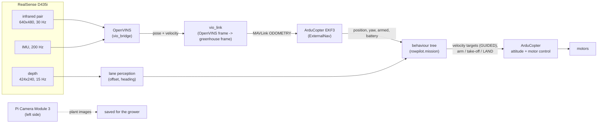
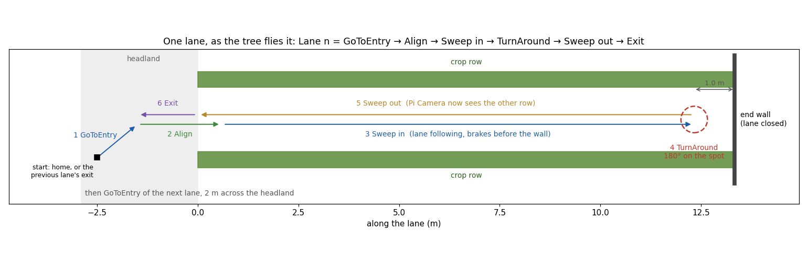
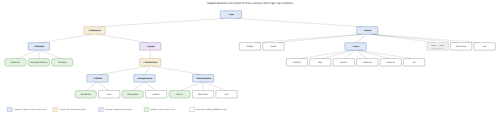
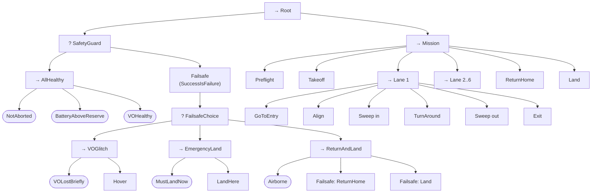
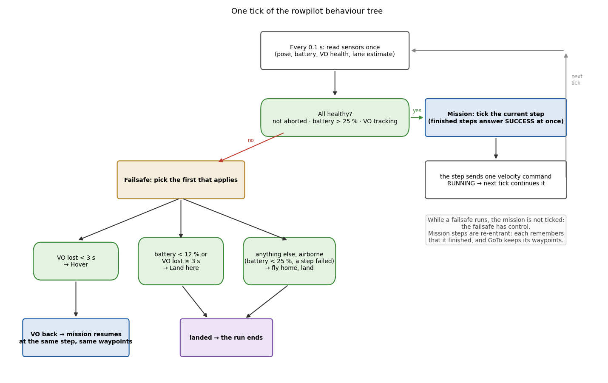
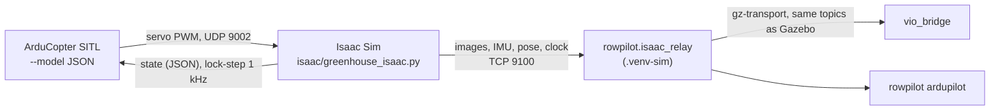
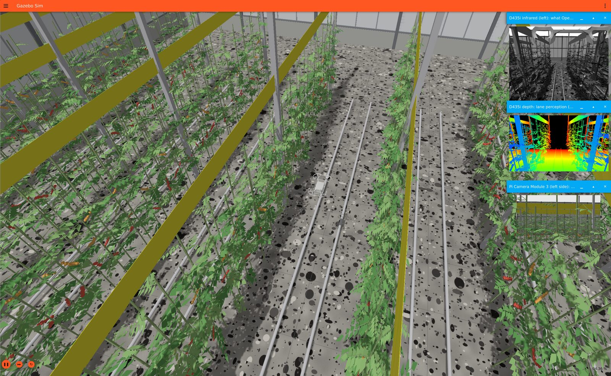
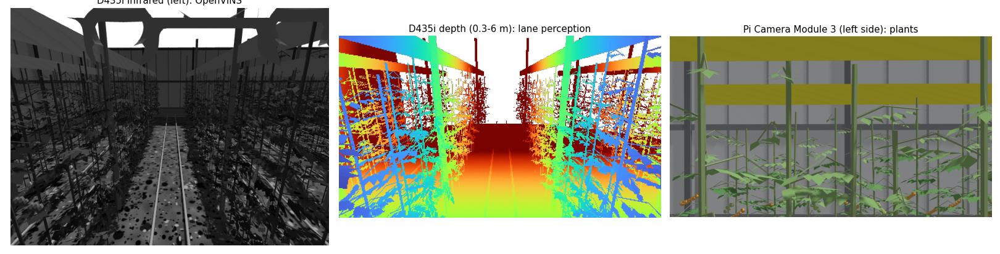
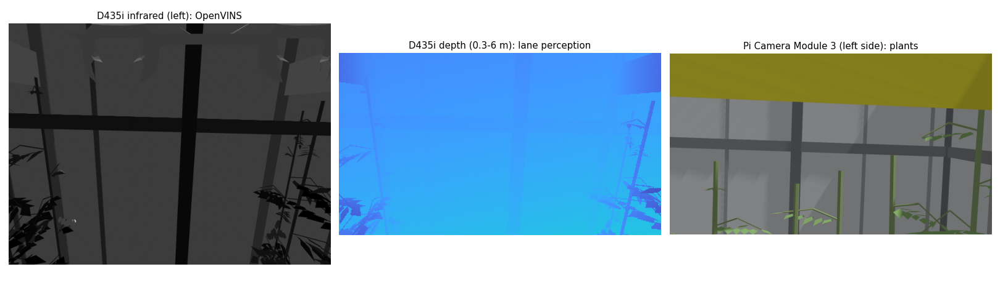

# How rowpilot works

This document explains the whole system: what runs where, how the pieces talk to each other, how the
behaviour tree flies the mission, and what every node does. The [README](../README.md) is the short
version; how to set up and run everything is in [setup.md](setup.md), every command and option in
[reference.md](reference.md), and the behaviour tree editor in [editor.md](editor.md).

Contents
1. [The big picture](#1-the-big-picture)
2. [Is this ROS? Processes, topics and messages](#2-is-this-ros-processes-topics-and-messages)
3. [The drone and its frames](#3-the-drone-and-its-frames)
4. [The greenhouse and the mission](#4-the-greenhouse-and-the-mission)
5. [The behaviour tree](#5-the-behaviour-tree)
6. [Every node, one by one](#6-every-node-one-by-one)
7. [What happens when things go wrong](#7-what-happens-when-things-go-wrong)
8. [Lane perception](#8-lane-perception)
9. [Control](#9-control)
10. [Localization: from cameras to the flight controller](#10-localization-from-cameras-to-the-flight-controller)
11. [Talking to ArduPilot](#11-talking-to-arducopter)
12. [The two simulators](#12-the-two-simulators)
13. [What each run saves, and where](#13-what-each-run-saves-and-where)
14. [What the cameras see](#14-what-the-cameras-see)
15. [Parameters you may want to change](#15-parameters-you-may-want-to-change)
16. [Adding a node to the tree](#16-adding-a-node-to-the-tree)

---

## 1. The big picture

The drone flies the lanes between tomato rows in a greenhouse, with no GPS and no compass. It knows
where it is from **visual-inertial odometry** (OpenVINS on the RealSense D435i's infrared cameras and
IMU), keeps itself in the middle of each lane from the **depth image** (the crop rows are two walls),
and a **behaviour tree** decides what to do next: take off, fly into each lane and back out, return,
land, and react to a low battery or lost tracking.



Who decides what:
- **The behaviour tree** (Python, on the Pi 5) decides *where to go*: it sends body-frame velocity
  targets ("1 m/s forward, 0.1 m/s left, turn 0.2 rad/s") ten times a second.
- **ArduCopter** (on the flight controller) decides *how to fly there*: attitude, thrust, motors. It
  also fuses OpenVINS into its own position estimate (EKF3), takes off, and lands.
- **OpenVINS** says *where the drone is* (drifts slowly). **Lane perception** says *where the lane
  centre is* (does not drift, but only exists inside a lane). The tree combines both.

## 2. Is this ROS? Processes, topics and messages

**No, rowpilot does not use ROS** (neither ROS 1 nor ROS 2). Nothing in it needs a ROS install:

| What ROS would give | What rowpilot uses instead |
|---|---|
| Nodes | Separate processes: Gazebo, `vio_bridge` (C++, OpenVINS as a library), `imu_synth`, `rowpilot` (the tree), ArduCopter; the editor's server, if it started the run |
| Topics | **gz-transport**: Gazebo's own publish/subscribe (same idea: named topics, typed messages, many subscribers) |
| Messages | **gz.msgs** (protobuf): `Image`, `IMU`, `Odometry`, `Pose_V`, `Clock` |
| Talking to the flight controller (MAVROS) | **MAVLink** directly, with pymavlink |
| rosbag | each run's `trace.json`, `events.jsonl` and ArduPilot's `.BIN` log |

Why: OpenVINS runs as a library inside `vio_bridge`, ArduPilot speaks MAVLink, and the behaviour tree
is plain Python, so ROS would only add a large dependency (and a SkiffOS image with ROS on the Pi 5).
On the real drone the same processes run, with librealsense in place of the Gazebo cameras: see
[deployment.md](deployment.md) for what carries over and what still has to be written.

### Looking at topics

Gazebo's command line shows what is on the topics while a simulation runs:

```bash
export GZ_IP=127.0.0.1
gz topic -l                                  # all topics
gz topic -i -t /gh_firefly/depth             # who publishes / subscribes, and the message type
gz topic -e -t /rowpilot/vio/odometry -n 1   # print one message
gz topic -f -t /gh_firefly/infra1            # rate (Hz)
```

| Topic | Message | From → to | What it is |
|---|---|---|---|
| `/gh_firefly/infra1`, `/infra2` | Image (L8) | Gazebo → vio_bridge | D435i stereo infrared, 30 Hz |
| `/gh_firefly/d435i_imu` | IMU | Gazebo → imu_synth | D435i IMU, 200 Hz |
| `/model/gh_firefly/pose` | Pose_V | Gazebo → imu_synth | link poses at 1 kHz (simulation only) |
| `/gh_firefly/d435i_imu_kin` | IMU | imu_synth → vio_bridge | the IMU with a physics-based accelerometer (simulation only, see §10) |
| `/rowpilot/vio/odometry` | Odometry | vio_bridge → rowpilot | OpenVINS pose and velocity of the D435i |
| `/gh_firefly/depth` | Image (R_FLOAT32) | Gazebo → rowpilot | depth, 15 Hz, for lane perception |
| `/gh_firefly/picam` | Image (RGB) | Gazebo → (saved) | Pi Camera Module 3, plant images |
| `/world/greenhouse/clock` | Clock | Gazebo → rowpilot | simulation time: the tree ticks on it |
| `/world/greenhouse/pose/info` | Pose_V | Gazebo → rowpilot | ground truth, **only for scoring** |
| MAVLink tcp:5760 | ODOMETRY, SET_POSITION_TARGET_LOCAL_NED, COMMAND_LONG / HEARTBEAT, LOCAL_POSITION_NED, ATTITUDE, SYS_STATUS | rowpilot ⇄ ArduCopter | see §11 |
| JSON UDP 9002 | motor PWM / IMU, pose (lock-step) | ArduCopter ⇄ Gazebo plugin | the simulated motors and IMU |

## 3. The drone and its frames

The **FireFly 2**: quad X, 2004 motors with 4-inch props, 4S Molicel P42A pack, Raspberry Pi 5
companion computer (SkiffOS), ArduCopter flight controller, RealSense D435i at the front tilted 15°
down, Pi Camera Module 3 on the left, TF-Luna rangefinder (not used yet). Its simulation model is
built from the SolidWorks design: `rowpilot/airframe.py` (what is measured and what is estimated is
listed there) and `rowpilot/cad_import.py`.

Frames (all right-handed):
- **Map M** = the greenhouse, ENU: origin at the start of lane 1, **x along the rows**, y across them
  (left when facing +x), z up. Gazebo's world frame is the same, so a Gazebo pose is a map pose.
- **Body B**: FLU (x forward, y left, z up), origin at the bottom centre of the FireFly's body.
- **D435i / IMU frame I**: at the D435i, tilted 15° down with it.
- **OpenVINS global frame G**: gravity-aligned, origin and heading where OpenVINS started.
- **ArduPilot local frame**: NED with the map's origin: north = map y, east = map x, down = −z.
  `yaw_NED = 90° − yaw_map`.

## 4. The greenhouse and the mission

`rowpilot/layout.py`: 6 lanes, rows 13.3 m long, lanes 1.6 m wide between the crop faces, crop rows
0.4 m wide (so lane centres are 2 m apart), a 1.5 m headland before the rows, home 1 m further back.

**The lanes are dead ends** (as in the real greenhouse): the far end is closed by the end wall, there
is no entry from the back. For every lane the drone:

1. crosses the headland to the lane entry and turns to face down the lane,
2. creeps in until the depth camera sees both crop faces and it is centred (**Align**),
3. flies down the lane on the perceived centre line (**Sweep in**), braking to stop 1 m before the
   end wall,
4. turns round on the spot (**TurnAround**: 180°, about 6 s; the lane is 1.6 m wide, the drone 0.38 m long),
5. flies back out on the centre line (**Sweep out**), with the Pi Camera now seeing the other row,
6. leaves the rows into the headland (**Exit**), back at the lane entry.



### How the drone knows where the next lane is

From the **greenhouse map**, not by searching for it. The layout (`GreenhouseLayout` in
`rowpilot/layout.py`) knows where every lane is: lane centres are one *pitch* apart (lane width + crop
row width = 1.6 m + 0.4 m = 2 m), lane 1 runs along y = 0 starting at x = 0. Lane *k*'s **entry** is
in the headland, 1.5 m before the rows, on the lane's centre line:

    entry(k) = (x = −headland, y = (k − 1) × pitch)      e.g. lane 3: (−1.5 m, 4.0 m)

(`GreenhouseLayout.lane_entry`; with open lanes, odd lanes are entered from the far end instead.)

1. **GoToEntry** (`GoToLaneEntry`) flies there on the visual odometry position (in Gazebo: ArduPilot's
   EKF3, fed by OpenVINS), first back out through the previous lane's exit, then across the headland,
   and turns to face down the lane. Visual odometry drifts by a few centimetres, so the drone arrives
   *roughly* in front of the lane.
2. **Align** (`AlignToLane`) then uses the **depth camera**: it creeps forward until it sees both crop
   faces, and steers until it is centred and straight (within 8 cm and 4° over a second). This is what
   puts the drone accurately into the lane, whatever the odometry error.
3. While sweeping, the known lane centre corrects the odometry's sideways drift (lane-centric
   localization, §9), so the next lane's entry is found from a corrected position.

So the map gives *where to go* and the camera gives *exactly where the lane is*. Nothing searches for
lane openings: for the real greenhouse, measure the lane width, crop row width, row length, headland
and home position and put them into the layout (or the editor's Run settings). Detecting the openings
with the depth camera while crossing the headland would make the map less critical; it is not done yet.

Then the next lane, and finally home and land. With `--open-ends` (`GreenhouseLayout(closed_end=False)`)
the lanes are open at both ends and swept serpentine instead (in one end, out the other).

## 5. The behaviour tree

### What a behaviour tree is

A behaviour tree is a way to write a robot's decision-making as a tree of small, reusable nodes.
Ten times a second the tree is **ticked**: the root is asked "what is your status?", it asks its
children, and so on down. Every node answers one of:

- **SUCCESS**: I am done (or: my condition is true),
- **FAILURE**: I cannot do it (or: my condition is false),
- **RUNNING**: I am working on it, ask me again next tick.

Leaves do the work: **conditions** check something and answer SUCCESS/FAILURE at once; **actions**
send commands and usually answer RUNNING until they finish. Inner nodes combine children:

- **Sequence** (→): ticks its children in order; stops at the first one that is not SUCCESS and
  returns that. It succeeds when all children succeed. "Do A, then B, then C."
- **Selector** / Fallback (?): ticks its children in order; stops at the first one that is not
  FAILURE. It fails when all fail. "Try A; if that fails, try B."
- **Decorator**: changes one child's answer (here: `SuccessIsFailure`).

rowpilot uses [py_trees](https://py-trees.readthedocs.io/). All composites are built with
`memory=False`: they **start from their first child on every tick**. That is what makes the safety
checks run every tick, in front of whatever the mission is doing.

Why a tree and not a state machine: adding a check or a failsafe is adding a node, not rewiring
transitions between states; the priorities are visible in the shape of the tree; and each node can
be tested on its own.

### The rowpilot tree



`python -m rowpilot tree` prints it; `python -m rowpilot tree --json` exports nodes and edges.

```
Root (Sequence)
├── SafetyGuard (Selector)
│   ├── AllHealthy (Sequence)
│   │   ├── NotAborted
│   │   ├── BatteryAboveReserve
│   │   └── VOHealthy
│   └── Failsafe (SuccessIsFailure)
│       └── FailsafeChoice (Selector)
│           ├── VOGlitch (Sequence): VOLostBriefly → Hover
│           ├── EmergencyLand (Sequence): MustLandNow → LandHere
│           └── ReturnAndLand (Sequence): Airborne → Failsafe: ReturnHome → Failsafe: Land
└── Mission (Sequence)
    ├── Preflight
    ├── Takeoff
    ├── Lane 1 (Sequence): GoToEntry → Align → Sweep in → TurnAround → Sweep out → Exit
    ├── Lane 2 ... Lane 6 (the same)
    ├── ReturnHome
    └── Land
```



(Rounded boxes are conditions, square boxes are actions; → is a Sequence, ? a Selector.)

### How a tick flows



Every tick (`MissionContext.pre_tick`, then `root.tick_once()`):

1. **Read the sensors once** (`pre_tick`): the vehicle state (position, yaw, battery, armed, VO
   healthy) and one depth image turned into a lane estimate. Every node in this tick sees the same
   snapshot.
2. **Root ticks SafetyGuard first.** If `AllHealthy` succeeds (not aborted, battery above the
   reserve, VO tracking), the guard succeeds and Root moves on to the Mission.
3. **Root ticks the Mission.** The Sequence skips the steps that are already done (each remembers
   it, see below) and ticks the current one, which sends one velocity command and answers RUNNING.
4. If a health check fails, **AllHealthy fails, so the guard tries Failsafe**: it picks the first
   applicable reaction (a short VO glitch → hover; battery critical or VO lost for long → land here;
   anything else → fly home and land). While the failsafe is RUNNING, Root stops there and the
   mission is **not ticked**: the failsafe is in control. When the failsafe *finishes* (landed), the
   decorator turns its SUCCESS into FAILURE, the guard fails, Root fails, and the run ends.
5. After a VO glitch (VO back within 3 s), `AllHealthy` succeeds again on the next tick, the guard
   succeeds, and the mission continues **where it was**.

### Re-entrant nodes: the one design rule

Because the guard can interrupt the mission at any tick, and `memory=False` restarts Sequences from
the first child, every mission step is a `Once` node: it records its own name in `ctx.done` when it
succeeds and from then on answers SUCCESS at once without doing anything. So after an interruption
the Mission Sequence quickly passes the finished steps and resumes the unfinished one. Steps keep
their progress too: a `GoTo` that was interrupted keeps its remaining waypoints and does not re-plan
from the start; a `SweepLane` keeps its statistics.

**Keep this rule when adding nodes**: a mission step must be safe to tick again after being
interrupted, and must not redo work it finished.

## 6. Every node, one by one

### Conditions (answer at once)

| Node | SUCCESS when | Used for |
|---|---|---|
| `NotAborted` | no abort reason has been set | once something has failed for good, stay in the failsafe |
| `BatteryAboveReserve` | battery > `reserve_battery_pct` (25 %) | below it: stop the mission and fly home |
| `VOHealthy` | the visual odometry is tracking | not tracking: the failsafe decides |
| `VOLostBriefly` | VO not tracking, for less than `vo_glitch_timeout_s` (3 s) | hover through short glitches |
| `MustLandNow` | battery ≤ `critical_battery_pct` (12 %) or VO lost ≥ 3 s (sets the abort reason) | land where you are |
| `Airborne` | not on the ground | only fly home if flying |

### Actions

| Node | What it does | SUCCESS | FAILURE |
|---|---|---|---|
| `Preflight` | checks battery ≥ `min_start_battery_pct` (40 %) and VO tracking, then arms (ArduCopter: GUIDED, arm, take-off command) | armed | battery low, VO not tracking, or arming refused (aborts) |
| `Takeoff` | climbs to `altitude` (1.5 m) | within 0.1 m of it | – |
| `GoTo` (GoToEntry, Exit, TurnAround, ReturnHome) | flies through map waypoints on the VO position, following the straight line between them (cross-track correction); long legs turn to face the way first; optional final yaw | last waypoint reached (15 cm) and final yaw within 4° | – |
| `AlignToLane` | creeps forward at 0.15 m/s until both crop faces are seen, then centres with the lane follower | over the last 1 s: mean offset < 8 cm, mean heading < 4°, worst frame < 20 cm | not aligned within `align_timeout_s` (20 s) |
| `SweepLane` (Sweep in / Sweep out) | flies along the lane at `sweep_speed` (0.8 m/s) on the perceived centre line; slows down when off-centre; Sweep in brakes towards the turning point (speed = 0.5 × distance left); if the faces drop out it holds the lane on VO | reached its end (turning point, or the row start) | faces lost for `lane_lost_timeout_s` (5 s) away from the ends |
| `Hover` | holds position (zero velocity) | – (RUNNING until the guard stops ticking it) | – |
| `Land` / `MissionLand` | hands landing to the flight controller (ArduCopter LAND mode descends, detects touchdown, disarms) | landed and disarmed | – |

`FailsafeReturnHome` is `ReturnHome` that first records "battery low" as the abort reason.
`home_route` never cuts through the crop: from inside the rows it flies out along the lane axis to the
near headland, then across to home. (In a dead-end lane that is the only way out anyway.)

### The mission context

`MissionContext` (`rowpilot/mission.py`) is what nodes share: the vehicle, the layout, the parameters,
the per-tick snapshot `s`, the filtered lane estimate `lane`, the `done` set, the abort reason, the
lanes completed, and the **lane-centric localization** correction `y_bias`: inside a lane, pointing
along it, the lane centre's map y is known exactly, so the perceived offset says where the drone truly
is across the lane; the VO's y is nudged towards that (5 % per tick), which cancels VO's slow sideways
drift over a long mission.

## 7. What happens when things go wrong

| Situation | What the tree does | Tested by |
|---|---|---|
| VO drops out for under 3 s | `VOGlitch`: hover; when VO is back, the mission resumes at the same step, same waypoints | `test_short_vo_dropout_hovers_then_resumes`, `test_frequent_vo_glitches_resume_without_replanning` |
| VO lost for 3 s or more | `EmergencyLand`: land where it is (no position to fly home on) | `test_long_vo_dropout_lands_in_place` |
| Battery below 25 % | `ReturnAndLand`: fly home along the lane, land | `test_low_battery_returns_home_and_lands` |
| Battery below 12 % | `EmergencyLand` | |
| A step fails (cannot align, lane lost, arming refused) | the step sets the abort reason, `NotAborted` fails → `ReturnAndLand` (or nothing, if still on the ground) | |
| Battery below 40 % before take-off | `Preflight` fails, never takes off | `test_refuses_to_start_on_low_battery` |
| ArduCopter disarms in flight (its own crash check) | the run ends as "crashed" | (Gazebo runs) |

## 8. Lane perception

`rowpilot/sensors.py` (`depth_to_lane_scan`) and `rowpilot/perception.py`.

1. **Depth image → points.** Every second pixel of the D435i depth image becomes a 3D point, moved
   from the camera into the body frame (mount position and 15° tilt), then levelled with the drone's
   roll and pitch.
2. **Keep the foliage band.** Only points 0.6–2.4 m above the floor stay: the floor, the heating
   pipes and the roof are not lane walls.
3. **Collapse to a scan.** Per direction (96 bins across the field of view), the nearest point: a
   horizontal "lidar" scan of the lane walls, in the body frame.
4. **Drop surfaces that face the drone** (row ends, posts, the end wall): along the scan, a lane wall
   moves mostly forward, a facing surface mostly sideways.
5. **Fit the two crop faces.** The scan is split into left and right of the lane direction; each side
   gets a robust line fit (RANSAC, nearest well-supported line wins), then both faces are fitted
   together with one shared slope (they are parallel), using the back half of the points (stems line up,
   leaf tips do not).
6. **Sanity checks.** Faces must be one lane width apart (±25 cm) and not steeper than 35°. If anything
   is doubtful the answer is "don't know" (`valid=False`), never a guess.
7. **Output:** `lateral_offset` (m, positive = the lane centre is to the left) and `heading_error`
   (rad, positive = the lane runs to the left of the nose). `LaneFilter` smooths the heading (0.5 s),
   passes the offset straight through, and restarts after a gap of more than 1 s.

## 9. Control

`rowpilot/control.py`. All commands are body-frame velocities plus a yaw rate.

- **Lane follower** (Align, Sweep): PD on the lateral offset (`k_lat` 0.6, `kd_lat` 0.2, at most
  0.8 m/s sideways), P on the heading error (`k_yaw` 0.8, at most 0.8 rad/s), forward speed reduced
  when off-centre or misaligned (down to 20 %).
- **Waypoint following** (GoTo): speed proportional to the distance left along the line (`k_pos` 0.8,
  at most `transit_speed` 1.0 m/s), cross-track correction back onto the line (`k_cross` 0.9), turn on
  the spot first when more than 30° off on a long leg.
- **Altitude hold** in every command: vertical speed = 1.2 × height error, at most 0.8 m/s.

The gains are deliberately soft: ArduCopter follows GUIDED velocity targets with about 0.5 s dead
time and a 0.3 s lag (measured), and stiffer gains made the drone swing across the lane.

## 10. Localization: from cameras to the flight controller

1. **OpenVINS** (`vio_bridge/`, C++, OpenVINS as a library, no ROS) takes the D435i's two infrared
   images (30 Hz) and IMU (200 Hz) and estimates the IMU's pose and velocity in its own global frame G.
   It publishes `/rowpilot/vio/odometry`. Config: `rowpilot/openvins_config.py` (generated from the
   same sensor description as the drone model; on the real drone put your Kalibr calibration in).
2. **vio_link** (`rowpilot/vio_link.py`) turns that into the body pose in the greenhouse frame. The
   drone starts at the known home spot, so the fixed transform from G to the map is computed once from
   the first estimate: `T_M_G = T_M_B(home) · T_B_I · inv(T_G_I(first))`.
3. **To ArduPilot**: every estimate is sent as MAVLink `ODOMETRY` (frame LOCAL_FRD, child BODY_FRD).
   EKF3 is configured to take position, velocity, height and yaw from it (`EK3_SRC1_* = 6`,
   ExternalNav) and nothing from GPS or the compass (`ardupilot/gps_denied.parm`).
4. **Back to the tree**: `state()` reads EKF3's estimate (LOCAL_POSITION_NED, ATTITUDE), so the tree
   and the flight controller agree on where the drone is.

**Simulation only: `imu_synth`.** Gazebo's IMU sensor reports wrong linear accelerations while the
drone rotates, which made OpenVINS diverge in every turn. `rowpilot/imu_synth.py` keeps Gazebo's gyro
and computes the accelerometer from the physics (the sensor link's pose at 1 kHz), with BMI055-like
noise and bias. On the real drone the D435i's IMU goes straight to OpenVINS.

## 11. Talking to ArduCopter

`rowpilot/ardupilot.py`, over MAVLink (pymavlink), `tcp:127.0.0.1:5760` in SITL:

| Action | MAVLink |
|---|---|
| Set the EKF origin (needed for GUIDED without GPS) | SET_GPS_GLOBAL_ORIGIN |
| Arm and take off | GUIDED mode (DO_SET_MODE), COMPONENT_ARM_DISARM, NAV_TAKEOFF |
| Fly | SET_POSITION_TARGET_LOCAL_NED with frame BODY_NED, velocity and yaw-rate only |
| Land | LAND mode (ArduCopter descends, detects touchdown, disarms) |
| Read state | HEARTBEAT (armed, mode), LOCAL_POSITION_NED, ATTITUDE, SYS_STATUS (battery) |
| Feed the VIO | ODOMETRY |

Two ArduCopter behaviours the vehicle code handles: a velocity target during NAV_TAKEOFF cancels the
climb, so velocity targets are held back until the drone is airborne; and on the ground velocity
targets do not make it climb (it disarms instead).

## 12. The simulators

| | Python simulator (`rowpilot/sim.py`) | ArduPilot SITL + Gazebo |
|---|---|---|
| Run | `python -m rowpilot run`, or the editor (*Python simulator*) | `./scripts/run_ardupilot_sim.sh`, or the editor (*Gazebo + ArduPilot + OpenVINS*) |
| Speed | a full mission in ~1 s | real time (~7 min for 6 lanes) |
| Flight dynamics | velocity loop with ArduCopter's measured dead time and lag, gusts | ArduCopter + Gazebo physics with the FireFly model |
| Localization | VO with random-walk drift and scripted dropouts | OpenVINS on rendered infrared images |
| Depth | rays against the crop faces, row ends and end wall, with ragged foliage | Gazebo depth camera on procedural tomato plants |
| Use | tests (CI), trying mission logic quickly | the real drone's software chain end to end |
| Log | the tree's nodes | the tree's nodes, ArduPilot's messages, and (in the editor) MAVLink, EKF3 and OpenVINS progress |

The behaviour tree, perception and control code are the same in both: they only see the `Vehicle`
interface (`state`, `arm`, `send`, `land`, `depth_scan`; `rowpilot/vehicle.py`).

### Isaac Sim in place of Gazebo (`SIM=isaac`)

`SIM=isaac ./scripts/run_ardupilot_sim.sh`, or *Isaac Sim + ArduPilot + OpenVINS* in the editor, swaps
Gazebo for NVIDIA Isaac Sim 4.5 and keeps everything else: ArduCopter SITL, OpenVINS (`vio_bridge`),
the behaviour tree, the topics and the run folder.



- **Same greenhouse, Isaac Sim's look.** The layout is Gazebo's; the looks are Isaac Sim's. Each part gets
  an NVIDIA MDL material for what it is made of (`isaac_scene.look_for`: OmniGlass facades, steel posts
  and pipes, ground cover with a normal map), NVIDIA's HDRI sky lights the scene through the glass, and the
  plants are rebuilt in detail on the same skeleton (`greenhouse_assets.tomato_plant_parts`, shared with
  Gazebo's meshes): smooth stems, curved leaflet cards with a generated serrated leaflet texture cut out
  by alpha, smooth fruit (`isaac_plants.py`). Render cost per frame, all sensor cameras plus the follow
  view (RTX 4070 Laptop): about 80 ms, 67 ms headless; 49 ms with `ISAAC_LOOK=gazebo`. The Pi Camera
  renders only with `ISAAC_PICAM=1`, and `--quality high` (global illumination) is for stills.
  `isaac/greenhouse_isaac.py --preview <folder>` renders stills of the scene without ArduPilot.
- **Same geometry.** Isaac Sim does not load SDF, so `rowpilot/isaac_scene.py` reads the world
  `ardupilot/install.sh` generated (shapes, colours, floor texture, plant meshes; `GREENHOUSE_ARGS`
  included) and the Isaac app builds it in USD. The plants are one point instancer.
- **Same protocol to ArduPilot.** ArduPilot's JSON SITL interface, which ardupilot_gazebo's plugin also
  uses, so `gps_denied.parm` and `firefly.parm` carry over. One physics step per servo packet.
- **The FireFly as one rigid body.** Mass, inertia and the collision box come from `airframe.py`.
  The four rotors are forces: speed from the PWM with a 10 ms lag, thrust proportional to speed²
  (7 N each at full speed), and the yaw reaction of the Gazebo blades
  (`rowpilot/isaac_link.py:RotorThrust`). The props do not spin visually.
- **The IMU comes from the physics.** The D435i accelerometer is computed as `imu_synth` computes it
  for Gazebo, and the gyro comes from the body's angular velocity, with the same BMI055 noise. The
  Isaac app publishes `/<model>/d435i_imu_kin` itself, so `imu_synth` does not run.
- **The window.** Isaac Sim renders headless; a window (`rowpilot/isaac_view.py`) shows a level camera following the drone and its cameras live, as the Gazebo window does. `ISAAC_WINDOW=1` opens Isaac Sim's own window instead, where the desktop allows it: on a desktop running on software rendering (`glxinfo -B` says llvmpipe), Isaac Sim cannot create its Vulkan window and crashes.
- **The relay** exists because Isaac Sim ships its own Python, which cannot load the system's
  gz-transport bindings. It republishes the stream on `/gh_firefly/{infra1,infra2,depth,picam}`,
  `/gh_firefly/d435i_imu_kin`, `/world/greenhouse/pose/info` and `/world/greenhouse/clock`.

Things to check on a first run: the image stamps against the IMU (rendering is set to synchronous so
that an image belongs to the step it is stamped with), and the real-time factor that `isaac.log`
prints every 10 simulated seconds.

## 13. What each run saves, and where

| Run | Folder | Files |
|---|---|---|
| Python simulator | the `--out` folder you give, e.g. `runs/nominal/` | `path.png` (the path plot), `summary.json`, `events.jsonl`, `trace.csv` |
| Editor, Python simulator | kept in the editor while it runs (the Log tab, the map) | not saved to disk |
| Editor, Gazebo | `runs/editor-<date>-<time>-<id>/` | as a terminal Gazebo run, plus `tree.json` (the tree that flew) |
| ArduPilot + Gazebo | `runs/ardupilot-<date>-<time>/` | `path.png`, `summary.json`, `events.jsonl`, `trace.json`, `logs/*.BIN` (ArduPilot dataflash log), `gazebo.log`, `arducopter.log`, `openvins.log`, `imu_synth.log` |
| ArduPilot + Isaac Sim | `runs/ardupilot-<date>-<time>/` (editor: `runs/editor-...`) | as above, with `isaac.log` and `isaac_relay.log` in place of `gazebo.log` and `imu_synth.log` |
| Camera views | `docs/views/` (or `--out`) | from `scripts/camera_views.py` |

`runs/` is not committed to git. The pictures in the README are copies kept in `docs/`.

- **`path.png`**: the greenhouse from above, crop rows in green, the true path in blue, what the drone
  believed (VO estimate) dashed orange, the end wall, home and the end point; the title has the outcome,
  lanes done, time, battery and the worst distance from the lane centre.
- **`summary.json`**: outcome, duration, battery left, lanes completed, RMS and worst distance from the
  lane centre (against ground truth).
- **`events.jsonl`**: one line per event: every node's status change and every log line, with time.
  This is what a node editor would replay.
- **`trace.json` / `trace.csv`** (10 Hz): estimated and true pose, height, battery, active node, lane
  estimate, commands sent.
- **ArduPilot `.BIN`**: everything inside the flight controller (attitude, rates, motor outputs, EKF,
  vibration). Open it with MAVExplorer or UAV Log Viewer (plot.ardupilot.org).

## 14. What the cameras see

**Live, in the Gazebo window.** `run_ardupilot_sim.sh` opens Gazebo with its own layout
(`ardupilot/gui.config`): the 3D view follows the drone, and three screens on the right show the
D435i infrared image (what OpenVINS tracks), the D435i depth image colour-coded (blue near, red far;
`rowpilot/depth_view.py` converts it for display) and the Pi Camera Module 3. Drag or resize the
screens as you like; close one with its ×. The 3D view can be moved with the mouse (that stops the
following; right-click the drone → Follow to resume).



**Saved pictures.** `scripts/camera_views.py` saves the three cameras' current images from a running simulation:

```bash
GZ_IP=127.0.0.1 PYTHONNOUSERSITE=1 .venv-sim/bin/python scripts/camera_views.py --out docs/views --prefix lane-
```

In a lane (D435i infrared: what OpenVINS tracks; D435i depth: what the lane perception uses, blue =
near, red = far; Pi Camera Module 3 on the left: the crop row):



Turning round at the end wall: the D435i sees mostly the glass facade, with few features to track
and no crop faces. Turns are short (≈6 s) and the drone holds position on OpenVINS meanwhile; on the
real drone this is the place to watch OpenVINS closely.



## 15. Parameters you may want to change

| What | Where | Default |
|---|---|---|
| Flight height, sweep and transit speed | `MissionParams` in `rowpilot/mission.py` | 1.5 m, 0.8 m/s, 1.0 m/s |
| Battery thresholds | `MissionParams` | start ≥ 40 %, reserve 25 %, critical 12 % |
| VO glitch tolerance, align and lane-lost timeouts | `MissionParams` | 3 s, 20 s, 5 s |
| Greenhouse size, lanes, closed or open ends, how close to the end wall | `GreenhouseLayout` in `rowpilot/layout.py` (or `--lanes`, `--length`, `--path-width`, `--open-ends`) | 6 lanes, 13.3 m, 1.6 m, closed, 1.0 m |
| Controller gains | `rowpilot/control.py` | see §9 |
| Sensor placement | `FIREFLY_RIG` in `rowpilot/airframe.py` | D435i 6.7 cm ahead, 3.9 cm up, 15° down |
| FireFly mass, inertia, thrust | `FireFly` in `rowpilot/airframe.py` | 0.72 kg, 7 N per motor (estimates) |
| ArduCopter frame, battery, rate gains | `ardupilot/firefly.parm` | |
| GPS-denied EKF3 setup | `ardupilot/gps_denied.parm` | |

## 16. Adding a node to the tree

Example: take a photo of every plant position.

1. Write the node in `rowpilot/mission.py`. A mission step subclasses `Once` (so it is re-entrant):
   implement `start()` (called when it starts, or resumes after an interruption) and `run()` (called
   every tick; return `Status.RUNNING`, `Status.SUCCESS`, or `self.fail("reason")`). A check subclasses
   `Condition` and implements `check()`.
2. Read the world only from `self.ctx.s` (the tick's snapshot) and `self.ctx.lane`; act only through
   `self.ctx.send(Command(...))` or the vehicle's `land()` / `arm()`.
3. Put it into `build_tree` where it belongs (e.g. after `Sweep in` in each lane's Sequence).
   To offer it in the editor's palette too, add a `NodeType` for it to `NODE_TYPES` in
   `rowpilot/editor/nodes.py` (its category, a one-line help, its parameters and a builder), and, if
   the mission tree uses it, the same step to `_add_lane` / `default_graph` there:
   `tests/test_editor.py` checks that the editor's mission tree still equals `build_tree`.
4. Log with `self.log("...")`: it appears in the console, in `events.jsonl` and in the node's
   `feedback_message`.
5. Add a test in `tests/test_mission.py` that runs a mission in the Python simulator and checks the
   events (see the existing tests), and run `pytest -q`.
