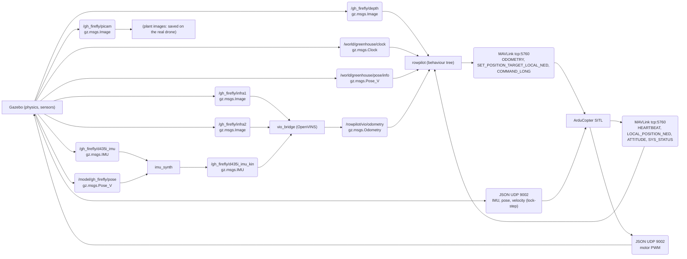

# Processes, topics and messages

Generated from the running simulation by `scripts/topic_graph.py` (the simulation's rqt_graph).
Boxes are processes; rounded boxes are topics or links, with their message type.

| Publisher | Topic / link | Message | Subscriber |
|---|---|---|---|
| Gazebo (physics, sensors) | `/gh_firefly/d435i_imu` | gz.msgs.IMU | imu_synth |
| Gazebo (physics, sensors) | `/gh_firefly/depth` | gz.msgs.Image | rowpilot (behaviour tree) |
| Gazebo (physics, sensors) | `/gh_firefly/infra1` | gz.msgs.Image | vio_bridge (OpenVINS) |
| Gazebo (physics, sensors) | `/gh_firefly/infra2` | gz.msgs.Image | vio_bridge (OpenVINS) |
| Gazebo (physics, sensors) | `/gh_firefly/picam` | gz.msgs.Image | (plant images: saved on the real drone) |
| Gazebo (physics, sensors) | `/model/gh_firefly/pose` | gz.msgs.Pose_V | imu_synth |
| Gazebo (physics, sensors) | `/world/greenhouse/clock` | gz.msgs.Clock | rowpilot (behaviour tree) |
| Gazebo (physics, sensors) | `/world/greenhouse/pose/info` | gz.msgs.Pose_V | rowpilot (behaviour tree) |
| imu_synth | `/gh_firefly/d435i_imu_kin` | gz.msgs.IMU | vio_bridge (OpenVINS) |
| vio_bridge (OpenVINS) | `/rowpilot/vio/odometry` | gz.msgs.Odometry | rowpilot (behaviour tree) |
| rowpilot (behaviour tree) | `MAVLink tcp:5760` | ODOMETRY, SET_POSITION_TARGET_LOCAL_NED, COMMAND_LONG | ArduCopter SITL |
| ArduCopter SITL | `MAVLink tcp:5760` | HEARTBEAT, LOCAL_POSITION_NED, ATTITUDE, SYS_STATUS | rowpilot (behaviour tree) |
| ArduCopter SITL | `JSON UDP 9002` | motor PWM | Gazebo (physics, sensors) |
| Gazebo (physics, sensors) | `JSON UDP 9002` | IMU, pose, velocity (lock-step) | ArduCopter SITL |
